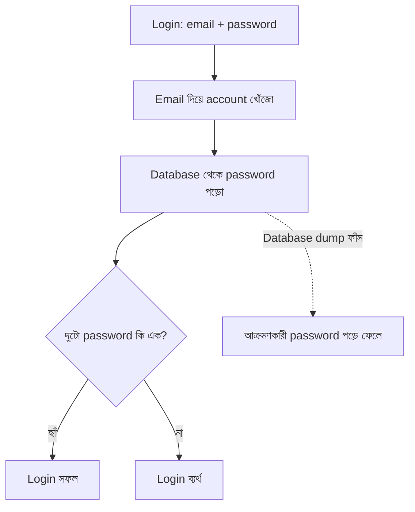
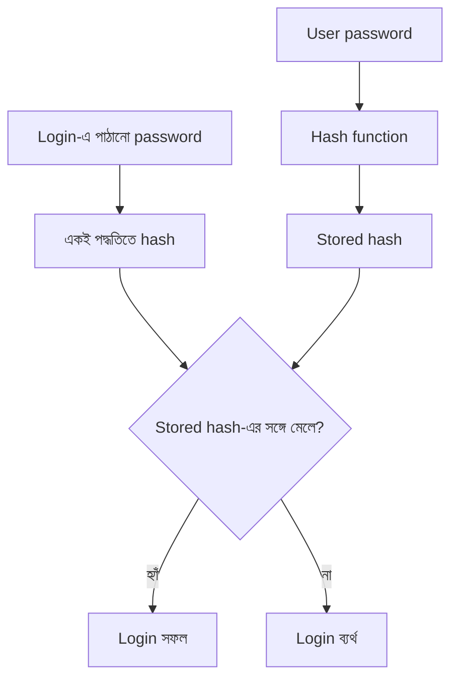
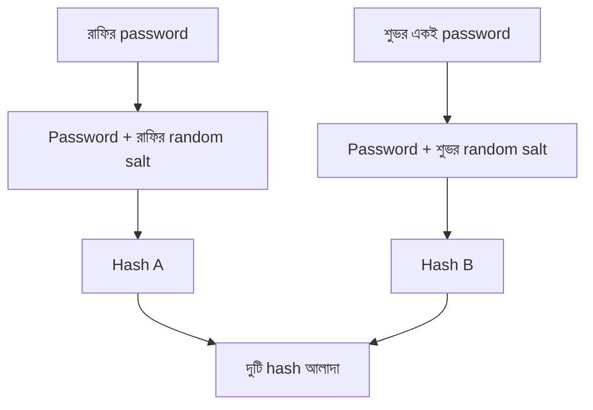

# প্রথম Login System এবং Password Security

বৃহস্পতিবার ভোর, ৬টা ৪০। আরিফের ফোনে একটা email এল।

> **বিষয়: আপনাদের database backup ইন্টারনেটে খোলা**
>
> ভাই, একটা public link-এ `kenakata-backup.sql.gz` নামে ফাইল পেলাম। ভেতরে KenaKata নামটা আছে। তাই জানাচ্ছি।

আরিফের মনে পড়ল, তিন সপ্তাহ আগে সে একটা backup বন্ধুকে পাঠিয়েছিল migration দেখানোর জন্য। এমন share link ব্যবহার করেছিল, যেখানে link যার কাছে আছে, সে-ই ফাইল খুলতে পারে। লিংকটা এরপর কোথায় গেছে, তার হিসাব তার কাছে নেই।

অধ্যায় ১-এর গোপন URL মনে আছে? "যার কাছে আছে, সে-ই সব।" একই ভুল, এবার অন্য দরজা দিয়ে।

আরিফ ফাইলটা নামাল। `users` table খুলল। কয়েক সেকেন্ড পরেই বুঝল, backup বাইরে যাওয়াটাই একমাত্র সমস্যা নয়। ফাইলের ভেতরে কী রাখা ছিল, সেটাও বড় সমস্যা।

এই অধ্যায়ে আমরা আরিফের সেই ভুল থেকে শুরু করব। Password কীভাবে রাখতে হয়, কেন শুধু hash বললেই কাজ শেষ হয় না, আর database ফাঁস হলে আক্রমণকারী কী করতে পারে, ধাপে ধাপে দেখব।

## এই অধ্যায়ে কী বুঝবে

- Password সংরক্ষণে encryption আর hashing-এর পার্থক্য।
- Hash, salt, Argon2id ও pepper কীভাবে আলাদা ঝুঁকি কমায়।
- Online ও offline guessing কেন আলাদা সমস্যা।
- Password policy, rate limiting, credential stuffing এবং MFA-র ভূমিকা।
- Password storage-এর সীমাবদ্ধতা ও production trade-off।

## ১. আধ ঘণ্টার login

অধ্যায় ১-এ আরিফ `authenticate`-এর ভেতরের কাজটা ফাঁকা রেখেছিল। অধ্যায় ২-এ আমরা ধরে নিয়েছিলাম, ওই কাজ ঠিকঠাক হয়। কিন্তু কোনো একসময় password যাচাইয়ের নিয়ম লিখতে হয়েছে।

আরিফের দরকার ছিল দুটো জিনিস: user-এর email ও password রাখার জায়গা, আর login-এর সময় পাঠানো email-password জোড়া ঠিক কি না তা যাচাই করার ব্যবস্থা।

প্রথম সংস্করণে database-এ সে password-ই রেখে দিল।

| id | email | password |
|---|---|---|
| `user-1` | `rafi@example.com` | `rafi1985` |
| `user-4` | `shuvo@example.com` | `shuvo@123` |
| `user-7` | `tuli@example.com` | `Tuli2024!` |

এগুলো কাল্পনিক account এবং দুর্বল password-এর উদাহরণ।



এটি ধারণাগত flow। বাস্তব query-তে user-এর email parameter হিসেবে দিতে হবে, query string-এর সঙ্গে সরাসরি জুড়ে নয়।

আরিফ পরীক্ষা করল। ঠিক password দিলে login হয়, ভুল দিলে হয় না। আধ ঘণ্টায় কাজ শেষ।

কিন্তু একটা অস্বস্তিকর সত্য আছে: **functional test পাস করা আর নিরাপদ হওয়া এক কথা নয়।** Functional test জিজ্ঞেস করে, "ঠিক মানুষ ঢুকতে পারছে তো?" Security জিজ্ঞেস করে, "এই তথ্য অন্যের হাতে গেলে কী হবে?"

## ২. Backup খুলে কী দেখা গেল

আরিফের database-এ password column-টি এমন ছিল:

```text
id      | email              | password
--------+--------------------+-----------
user-1  | rafi@example.com   | rafi1985
user-4  | shuvo@example.com  | shuvo@123
user-7  | tuli@example.com   | Tuli2024!
```

আক্রমণকারীকে কোনো password ভাঙতে হয়নি। ফাইল পড়লেই সব পাওয়া গেল।

ক্ষতিটা শুধু তিনটি account-এ সীমাবদ্ধ নয়।

**প্রথম ক্ষতি: account takeover।** আক্রমণকারী রাফির password জানে। সে রাফি সেজে login করতে পারে। অধ্যায় ২-এর `can(user-1, RefundOrder)` তখনও `true` দেবে, কারণ authorization system-এর চোখে request-টি রাফির। Authorization ভুল পরিচয়কে ঠিক করে দিতে পারে না।

**দ্বিতীয় ক্ষতি: password reuse।** মানুষ অনেক account চালায়। মনে রাখার সুবিধার জন্য একই password বা তার সামান্য বদলানো রূপ বিভিন্ন জায়গায় ব্যবহার করে। KenaKata-র backup থেকে পাওয়া password অন্য account-ও খুলে দিতে পারে। Email account দখল হলে password reset-এর পথ ধরেও আরও account হারাতে পারে।

**তৃতীয় ক্ষতি: ভেতরের লোকের অপ্রয়োজনীয় ক্ষমতা।** Database administrator, backup পাওয়া freelancer, কিংবা log বা screenshot দেখা কর্মী, সবাই password পড়তে পারে। তাদের সবাই খারাপ মানুষ এমন নয়। কিন্তু system তাদের এমন ক্ষমতা দিয়েছে, যার দরকারই নেই। যে system পুরোনো password দেখাতে পারে, তার নকশায় সমস্যা আছে।

**চতুর্থ ক্ষতি: log-ও বিভ্রান্তিকর হয়ে যায়।** আক্রমণকারী যদি `user-4` সেজে কাজ করে, log-এ `by=user-4`-ই লেখা হবে। Log ঠিকভাবে কাজ করবে, কিন্তু ঘটনাটির প্রকৃত মানুষটিকে চিনতে পারবে না।

আরেকটি কথা: database-এ customer-এর নাম, ফোন ও ঠিকানাও ছিল। Password ঠিকভাবে রাখলেই ওই তথ্যগুলো সুরক্ষিত হয় না। সেগুলোর জন্য আলাদা access control ও data-protection ব্যবস্থা দরকার।

## ৩. আক্রমণকারী এখন কোথায়?

আরিফ এতদিন আক্রমণকারীকে কল্পনা করেছে server-এর সামনে দাঁড়ানো কেউ হিসেবে। সে `/login`-এ request পাঠায়। Server সেই request দেখতে পায়, গুনতে পারে, ধীর করতে পারে, এমনকি আটকে দিতে পারে।

এখন backup-টিও আক্রমণকারীর হাতে। সে নিজের computer-এ বসে কাজ করতে পারে। KenaKata-র server-এ আর request পাঠানোর দরকার নেই।

এই দুই অবস্থার নাম **online attack** এবং **offline attack**।

- **Online attack:** আক্রমণকারী আমাদের login endpoint দিয়ে password অনুমান করে। প্রতিটি চেষ্টা server-এর মধ্য দিয়ে যায়। তাই rate limit, monitoring বা CAPTCHA-র মতো নিয়ন্ত্রণ কাজে আসতে পারে।
- **Offline attack:** আক্রমণকারী database-এর কপি পেয়ে নিজের computer-এ password অনুমান করে। সে নিজের গতিতে চেষ্টা চালায়। আমাদের login endpoint, rate limit বা server log তার সেই চেষ্টাগুলো দেখতে পায় না।

একটা দোকানের কথা ভাবো। Online attack-এ কেউ দোকানের সামনের দরজায় দাঁড়িয়ে একের পর এক চাবি লাগিয়ে দেখছে। দোকানদার তাকে দেখতে পাচ্ছে, চেষ্টার সংখ্যা গুনতে পারছে। Offline attack-এ কেউ তালার যাচাই করার তথ্যের একটা কপি বাড়িতে নিয়ে গেছে। এখন সে দোকানের বাইরে বসে নিজের মতো পরীক্ষা করছে।

এখনও আমরা password hash কী, তা জানি না। আপাতত শুধু পার্থক্যটা মনে রাখো: **online আক্রমণ আমাদের server-এর নিয়ন্ত্রণের মধ্যে দিয়ে যায়; offline আক্রমণ যায় না।**

## ৪. Server-এর কি password মনে রাখা দরকার?

আরিফের প্রথম প্রস্তাব ছিল, "তাহলে password encrypt করে রাখি।"

শুনতে ভালো। Encryption-এ একটা গোপন key দিয়ে তথ্যকে এমন রূপে বদলানো হয়, যা key ছাড়া পড়া যায় না। পরে একই key বা সংশ্লিষ্ট key দিয়ে আগের তথ্য ফিরিয়ে আনা যায়।

কিন্তু একটু ভেবে দেখো। Login-এর সময় server-এর আসল password ফিরিয়ে আনার দরকার কী? User password পাঠালে server-এর শুধু জানতে হবে, "এটা কি সেই password, যেটা user আগে ঠিক করেছিল?"

Server-কে password **মনে রাখতে হয় না**। তাকে শুধু password **যাচাই করতে হয়**।

Encryption ব্যবহার করলে password ফেরত পাওয়ার ক্ষমতা কোথাও না কোথাও রাখতে হবে। সেই key application-এর configuration, secret store বা অন্য কোথাও থাকবে। Database dump-এর সঙ্গে key নাও যেতে পারে, কিন্তু application server বা backup-এ key ফাঁস হলে বিপদ আবার ফিরে আসে।

তাই password-এর জন্য সাধারণ নকশা হলো: আসল password সংরক্ষণ না করে তার একটি যাচাইযোগ্য ছাপ রাখা।

এই ছাপ তৈরির পদ্ধতির নাম **hashing**।

## ৫. Hash: password-এর একমুখী ছাপ

একটি hash function input নেয় এবং নির্দিষ্ট দৈর্ঘ্যের output তৈরি করে। একই input দিলে একই output পাওয়া যায়। Output দেখে আসল input বের করার কোনো সহজ, সরাসরি পথ নেই।

ধরা যাক, password হলো `rafi1985`। Server সেটির hash তৈরি করে database-এ রাখল। পরের বার রাফি login করলে server তার পাঠানো password-এর hash বের করে stored hash-এর সঙ্গে যাচাই করবে।



এবার database ফাঁস হলেও আক্রমণকারী সরাসরি `rafi1985` পড়তে পারবে না। কিন্তু এখানেই গল্প শেষ নয়।

আরিফ SHA-256 ব্যবহার করার কথা ভাবল। এটি পরিচিত cryptographic hash function। File integrity যাচাইয়ের মতো কাজে খুব উপযোগী। কিন্তু password সংরক্ষণের জন্য এটি উপযুক্ত নয়।

কেন?

একটি সাধারণ hash function দ্রুত হওয়ার জন্য তৈরি। দ্রুত হওয়া বেশিরভাগ কাজে ভালো গুণ। Password attack-এ সেটাই সমস্যা। Database dump হাতে পেলে আক্রমণকারী সম্ভাব্য password নিজে hash করে stored hash-এর সঙ্গে মিলিয়ে দেখতে পারে। SHA-256 এত দ্রুত যে বিপুল সংখ্যক অনুমান চালানো সম্ভব।

আরও দুটি সমস্যা আছে।

**একই password, একই hash।** দুই user একই password ব্যবহার করলে তাদের hash-ও এক হবে। আক্রমণকারী বুঝতে পারে কোন account-গুলো একই password ব্যবহার করছে।

**আগে থেকে হিসাব করে রাখা যায়।** পরিচিত password-গুলোর hash আগে থেকেই হিসাব করে বিশাল তালিকা বানানো যায়। পরে database dump পেলে সেই তালিকার সঙ্গে মিলিয়ে দেখা যায়। এ ধরনের precomputed তালিকার একটি পরিচিত নাম rainbow table।

Hash একমুখী হওয়া মানে password guess করা অসম্ভব নয়। আক্রমণকারী আসল hash উল্টো করে না; সে সম্ভাব্য password সামনে থেকে পরীক্ষা করে।

## ৬. Salt: একই password হলেও আলাদা ছাপ

একই password-এর hash যেন প্রতিটি account-এ আলাদা হয়, তার জন্য প্রতিটি password-এর সঙ্গে একটি আলাদা random মান যোগ করা হয়। এর নাম **salt**।

ধরা যাক, রাফি ও শুভ একই password ব্যবহার করে। Salt ছাড়া তাদের hash একই হতে পারে। কিন্তু প্রত্যেকের salt আলাদা হলে hash-ও আলাদা হবে।



Salt-এর কাজ দুটি:

1. একই password ব্যবহার করা account-গুলোর hash আলাদা করা।
2. আগে থেকে তৈরি rainbow table-কে কার্যত অকার্যকর করা। প্রতিটি salt-এর জন্য নতুন করে হিসাব করতে হবে।

একটি গুরুত্বপূর্ণ কথা: **salt গোপন নয়।** এটি hash-এর পাশেই database-এ রাখা হয়। আক্রমণকারী dump পেলে salt-ও পাবে। Salt কোনো password-কে নিজে থেকে শক্তিশালী করে না, আর প্রতিটি guess-কে ধীরও করে না। এটি শুধু একই password ও precomputed table-সংক্রান্ত সুবিধা কমায়।

প্রতিটি password-এর জন্য আলাদা, cryptographically secure random salt দরকার। ভালো password-hashing library সাধারণত salt তৈরি ও সংরক্ষণের কাজ নিজেই করে। নিজের হাতে salt বানানোর দরকার নেই।

## ৭. Password guess করাটাই ব্যয়বহুল করতে হবে

Salt একই password-এর hash আলাদা করে। কিন্তু আক্রমণকারী যদি একটি নির্দিষ্ট account-কে লক্ষ্য করে, তার salt জেনেই password guess করতে পারে। প্রতিটি অনুমান এখনও দ্রুত হলে দুর্বল password দ্রুত বেরিয়ে আসতে পারে।

তাই password storage-এর জন্য এমন algorithm দরকার, যা প্রতিটি guess-কে ইচ্ছা করে ব্যয়বহুল করে।

এখানেই **Argon2id** আসে। এটি password hashing-এর জন্য তৈরি algorithm। এটি সময়ের পাশাপাশি memory-ও ব্যবহার করে। ফলে অনেকগুলো guess একসঙ্গে চালানো আক্রমণকারীর জন্য ব্যয়বহুল হয়।

আরও কিছু নাম দেখা যেতে পারে:

- **scrypt:** memory-hard password hashing algorithm।
- **PBKDF2:** বহুদিনের ব্যবহৃত password-based key derivation function; নির্দিষ্ট compliance requirement-এ দেখা যায়।
- **bcrypt:** পুরোনো system-এ প্রচলিত। নতুন system-এ ব্যবহারের আগে এর input-length সীমাবদ্ধতা ও বর্তমান সুপারিশ বুঝতে হবে।

সাধারণ-purpose hash যেমন SHA-256 দ্রুত কাজ করার জন্য তৈরি। Password storage-এর জন্য উপযুক্ত password-hashing algorithm ব্যবহার করতে হবে। নতুন system-এ Argon2id সাধারণত ভালো default পছন্দ।

### কতটা ধীর হওয়া উচিত?

Hash যত ব্যয়বহুল হবে, আক্রমণকারীর প্রতিটি guess তত ব্যয়বহুল হবে। কিন্তু বৈধ user-এর login-ও তত বেশি CPU ও memory ব্যবহার করবে।

অতিরিক্ত কম cost আক্রমণকারীকে সুবিধা দেয়। অতিরিক্ত বেশি cost server-কে ধীর করে দিতে পারে, এমনকি login endpoint-কে denial-of-service-এর লক্ষ্য বানাতে পারে।

তাই production system-এ নিজের hardware ও concurrent login load মেপে configuration বেছে নিতে হয়। কোনো একটি parameter সব application-এর জন্য সঠিক নয়। রক্ষণাবেক্ষণাধীন library-এর বর্তমান recommendation দিয়ে শুরু করতে হবে, তারপর নিজের workload-এ পরীক্ষা করতে হবে।

### Database-এ ঠিক কী রাখব?

শুধু hash রাখলেই হবে না। পরের login-এ যাচাই করার জন্য algorithm, তার configuration এবং salt-ও দরকার। সাধারণত এগুলো encoded password-hash record-এ একসঙ্গে থাকে।

```text
password_hash:
  algorithm
  parameters
  salt
  derived hash
```

এই record-টি database থেকে এলেও অন্ধভাবে বিশ্বাস করা যাবে না। Algorithm ও parameter অবশ্যই application-এর অনুমোদিত সীমার মধ্যে থাকতে হবে। অজানা algorithm বা অস্বাভাবিক resource setting পেলে login ব্যর্থ করতে হবে। নইলে database-এ record বদলে দিয়ে কেউ login verification-কে অতিরিক্ত ব্যয়বহুল করাতে পারে।

## ৮. Pepper: আরেকটি গোপন উপাদান

Salt সবার জন্য আলাদা এবং গোপন নয়। **Pepper** তার উল্টো: এটি একটি secret, সাধারণত সব password-এর জন্য একই, এবং database-এর বাইরে রাখা হয়।

Database dump একা পেলে আক্রমণকারী pepper পাবে না। ফলে hash যাচাইয়ের কাজে অতিরিক্ত একটি বাধা তৈরি হয়।

কিন্তু pepper salt-এর বিকল্প নয়। এটি defense in depth-এর একটি অতিরিক্ত স্তর। Pepper আলাদা secret manager বা hardware-backed store-এ রাখতে হয়। Pepper ফাঁস হলে সেটি বদলানোর পরিকল্পনাও দরকার। পুরোনো password হাতে না থাকলে নতুন pepper দিয়ে পুরোনো hash পুনরায় তৈরি করা যায় না, তাই rotation জটিল হতে পারে।

এই অধ্যায়ের KenaKata উদাহরণে আমরা pepper ব্যবহার করছি না। Salt ও সঠিক password-hashing algorithm-ই মূল ভিত্তি।

## ৯. এবার পরীক্ষা: কোন নিয়ন্ত্রণ কোথায় কাজ করে?

এখন পর্যন্ত আমরা জেনেছি hash, salt এবং ধীর password hashing কী করে। এবার সিদ্ধান্ত নেওয়া সহজ।

**Decision Game**

KenaKata-র database dump আক্রমণকারীর হাতে গেছে। সে নিজের computer-এ password অনুমান করছে। কোন ব্যবস্থা offline guessing-এর খরচ বাড়ায়?

- A. `/login` endpoint-এ প্রতি IP-তে rate limit
- B. প্রতিটি password-এর জন্য random salt এবং Argon2id
- C. Login page-এ CAPTCHA
- D. ভুল password হলে account সাময়িক lock করা

<details>
<summary>উত্তর ও ব্যাখ্যা দেখো</summary>

**সঠিক উত্তর: B।** Salt একই password-এর hash আলাদা করে এবং precomputed table-এর সুবিধা কমায়। Argon2id প্রতিটি guess-কে সময় ও memory-র দিক থেকে ব্যয়বহুল করে।

A, C ও D login endpoint দিয়ে আসা online request নিয়ন্ত্রণ করতে পারে। কিন্তু আক্রমণকারী নিজের computer-এ dump নিয়ে কাজ করলে ওই নিয়ন্ত্রণগুলো তার সামনে থাকে না।

**Edge case:** Argon2id দুর্বল password-কে শক্তিশালী করে দেয় না। `rafi1985`-এর মতো সহজ password এখনও guess করা সম্ভব, শুধু প্রতিটি চেষ্টার খরচ বাড়ে।

</details>

## ১০. Password কতটা শক্ত হওয়া দরকার?

ধীর hash আক্রমণকারীর সময় ও খরচ বাড়ায়। কিন্তু password যদি খুব সহজ হয়, সেই বাড়তি খরচও যথেষ্ট নাও হতে পারে।

আরিফ প্রথমে একটা নিয়ম লিখতে চেয়েছিল: বড় হাতের অক্ষর থাকতে হবে, ছোট হাতের অক্ষর থাকতে হবে, সংখ্যা থাকতে হবে, special character থাকতে হবে। শুনতে কঠোর, কিন্তু মানুষ এমন নিয়মে প্রায়ই predictable password বানায়: `Password1!`, `Summer2026!`।

NIST-এর বর্তমান Digital Identity Guidelines এই ধরনের বাধ্যতামূলক composition rule চাপাতে বলে না। তার বদলে কয়েকটি বিষয়ে জোর দেয়:

- Password যথেষ্ট লম্বা হতে দিতে হবে।
- পরিচিত, ফাঁস হওয়া বা সহজে অনুমানযোগ্য password blocklist দিয়ে আটকাতে হবে।
- Password manager ব্যবহার ও paste করার সুযোগ দিতে হবে।
- শুধু সময় পেরিয়েছে বলে সবাইকে নিয়মিত password বদলাতে বাধ্য করা উচিত নয়। Compromise-এর প্রমাণ পেলে বদলাতে হবে।
- Unicode password গ্রহণ করলে একইভাবে সংরক্ষণ ও যাচাই করতে হবে।

### Password length এবং passphrase

`rafi1985` ছোট এবং অনুমানযোগ্য। তার বদলে একাধিক শব্দের দীর্ঘ passphrase মনে রাখা সহজ হতে পারে, আর অনুমান করাও কঠিন হতে পারে। তবে শুধু শব্দ বেশি হলেই নিশ্চয়তা নেই; পরিচিত বাক্য, নাম বা উদ্ধৃতি আক্রমণকারীর তালিকায় থাকতে পারে।

Password manager ব্যবহারকারীকে প্রতিটি site-এর জন্য আলাদা random password রাখতে সাহায্য করে। এতে একটি site ফাঁস হলে অন্য site-এ একই password দিয়ে ঢোকার ঝুঁকি কমে।

### Unicode এবং বাংলা password

Password শুধু ইংরেজি অক্ষর, সংখ্যা আর punctuation নয়। User বাংলা বা অন্য Unicode character ব্যবহার করতে পারে।

একই দেখতে কিছু Unicode text ভিন্ন code point sequence দিয়ে তৈরি হতে পারে। তাই registration-এর সময় একভাবে normalize করে login-এর সময় অন্যভাবে করলে user নিজের password দিয়েও login করতে নাও পারে।

NIST Unicode password-এর ক্ষেত্রে NFC normalization-এর নির্দেশনা দেয়। গুরুত্বপূর্ণ হলো registration ও verification-এ একই নিয়ম ধারাবাহিকভাবে প্রয়োগ করা। Password-এর byte length আর character count এক নয়, তাই library ও protocol-এর সীমাবদ্ধতাও বুঝতে হবে।

## ১১. Login endpoint-ও নিরাপদ করতে হবে

Password storage ঠিক করলেই login endpoint নিরাপদ হয়ে যায় না।

### একই ভুল বার্তা

ধরা যাক, email না পেলে server বলে, "এই email-এ account নেই।" আর password ভুল হলে বলে, "Password ভুল।"

আক্রমণকারী অনেক email পরীক্ষা করে account-এর তালিকা বানাতে পারে। এটাকে **account enumeration** বলে।

তাই login ব্যর্থ হলে সাধারণত একই ধরনের বার্তা দিতে হয়: "Email বা password সঠিক নয়।" HTTP response-ও এমন হওয়া উচিত, যাতে account আছে কি না সহজে বোঝা না যায়।

এর একটা UX trade-off আছে। বৈধ user বুঝতে পারে না email ভুল, নাকি password ভুল। নিরাপত্তার জন্য এই অসুবিধা অনেক system-এ মেনে নেওয়া হয়।

### Response time-ও তথ্য ফাঁস করতে পারে

বার্তা একই হলেও response time আলাদা হতে পারে। Account না থাকলে server যদি সঙ্গে সঙ্গে উত্তর দেয়, আর account থাকলে password hash যাচাই করতে সময় নেয়, আক্রমণকারী অনেক request তুলনা করে account আছে কি না আন্দাজ করতে পারে।

একটি প্রচলিত কৌশল হলো account না পাওয়া গেলেও আগে থেকে তৈরি dummy password hash যাচাই করা। এতে response time কাছাকাছি রাখা সহজ হয়। তবে timing difference পুরোপুরি দূর হয়েছে, এমন নিশ্চয়তা নয়।

### Rate limiting এবং throttling

Online attack-এ আক্রমণকারী `/login`-এ অনেক request পাঠাতে পারে। Rate limiting ও throttling চেষ্টা নিয়ন্ত্রণ করে। শুধু IP address ধরে সীমা দিলে proxy network দিয়ে request ছড়িয়ে দেওয়া সম্ভব। তাই account, IP, device বা আচরণগত signal মিলিয়ে স্তরভিত্তিক নিয়ন্ত্রণ দরকার।

তবে account-কে স্থায়ীভাবে lock করে দেওয়াও বিপজ্জনক। আক্রমণকারী অন্যের email জেনে ইচ্ছা করে বারবার ভুল password পাঠিয়ে বৈধ user-কে আটকে রাখতে পারে। তাই progressive delay, risk-based challenge এবং user notification-এর মতো ব্যবস্থা বিবেচনা করতে হয়।

### Credential stuffing আর password spraying

এ দুটি brute force-এর মতোই দেখায়, কিন্তু এক নয়।

- **Brute force:** একটি account-এর জন্য অনেক সম্ভাব্য password চেষ্টা।
- **Password spraying:** অনেক account-এ অল্প কয়েকটি সাধারণ password চেষ্টা।
- **Credential stuffing:** অন্য কোনো service থেকে ফাঁস হওয়া email-password জোড়া এখানে চেষ্টা করা।

Credential stuffing-এর বিরুদ্ধে rate limit একা যথেষ্ট নয়। Proxy network, bot detection, compromised-password screening, MFA এবং অস্বাভাবিক login activity শনাক্ত করা একসঙ্গে কাজে লাগে।

## ১২. MFA কী করে, আর কী করে না?

**MFA (Multi-Factor Authentication)** মানে login-এর জন্য একাধিক ধরনের প্রমাণ চাওয়া। Password জানা একটি factor। এর সঙ্গে authenticator app-এর code, security key বা অন্য উপযুক্ত factor যোগ করা যেতে পারে।

MFA password hash cracking-এর খরচ বাড়ায় না। আক্রমণকারী database dump নিয়ে password guess করার সময় MFA তার হিসাবকে ধীর করে না।

কিন্তু আক্রমণকারী password জেনে গেলেও account-এ ঢোকার জন্য দ্বিতীয় factor দরকার হতে পারে। ফলে password leak থেকে সরাসরি account takeover-এর ঝুঁকি কমে।

সব MFA সমান phishing-resistant নয়। SMS বা টাইপ করা one-time code কিছু আক্রমণ ঠেকালেও phishing-এর বিরুদ্ধে সীমাবদ্ধতা আছে। Passkey ও WebAuthn আরও শক্তিশালী phishing-resistant পদ্ধতি। এগুলো এই সিরিজের পরের security chapter-এ বিস্তারিত আসবে।

## ১৩. Password storage-এর জীবনচক্র

আজকের algorithm চিরকাল যথেষ্ট থাকবে না। Hardware উন্নত হয়, আক্রমণকারীর হিসাব করার ক্ষমতাও বাড়ে। তাই password-hash configuration সময়ের সঙ্গে পর্যালোচনা করতে হয়।

অনেক system login-এর সময় stored hash-এর algorithm ও parameter পরীক্ষা করে। পুরোনো configuration হলে user-এর পাঠানো password দিয়ে নতুন configuration-এ hash তৈরি করে database update করে। একে **rehash on login** বলা হয়।

এর সীমাবদ্ধতা আছে: যে user আর login করে না, তার hash পুরোনোই থেকে যায়। দীর্ঘদিন নিষ্ক্রিয় account-এর ক্ষেত্রে reset বাধ্যতামূলক করা একটি বিকল্প, তবে এতে user friction বাড়ে।

### Password reset-ও একটি দরজা

Password ভুলে গেলে user-কে reset করতে হয়। কিন্তু reset link যদি দীর্ঘদিন valid থাকে, একাধিকবার ব্যবহার করা যায়, বা অনুমান করা সম্ভব হয়, তাহলে সেটাই account takeover-এর নতুন পথ।

এই অধ্যায়ে reset flow-এর সম্পূর্ণ implementation দেখানো হচ্ছে না। Reset token নিরাপদে issue, expire ও একবার ব্যবহারযোগ্য করা দরকার। Password reset-এর পর পুরোনো session কীভাবে বাতিল হবে, তা অধ্যায় ১৫-তে আসবে।

## ১৪. Threat model: আক্রমণকারী কী করতে পারে?

| আক্রমণকারীর সুযোগ | সম্ভাব্য কাজ | যে নিয়ন্ত্রণ সাহায্য করে |
|---|---|---|
| শুধু `/login`-এ request পাঠাতে পারে | Brute force, spraying, enumeration | Rate limit, throttling, generic response, monitoring |
| Database dump পেয়েছে | Offline password guessing | Salt, Argon2id, শক্ত password ও blocklist |
| অন্য site-এর credential পেয়েছে | Credential stuffing | MFA, compromised-password screening, bot detection |
| User-কে phishing করতে পারে | Password চুরি | Phishing-resistant MFA, passkey/WebAuthn |
| Application server-এ ঢুকেছে | Login-এর সময় plaintext password পড়া | Server security, secret handling, incident response |
| Database-এ লিখতে পারে | Stored hash বদলানো | Database integrity, least privilege, access monitoring |

এখানে একটি গুরুত্বপূর্ণ সীমা আছে: password hash database-এ থাকলেও আক্রমণকারী যদি database-এ লিখতে পারে, সে hash বদলে দিতে পারে। Password hashing database write access-এর বিকল্প প্রতিরক্ষা নয়।

## ১৫. Trade-off: নিরাপত্তারও দাম আছে

- **Login ধীর হয়।** Password hashing ইচ্ছাকৃতভাবে ব্যয়বহুল। বৈধ user-এর login-এও সেই খরচ পড়ে।
- **Server-এর resource লাগে।** অনেক login একসঙ্গে এলে CPU ও memory চাপের মুখে পড়ে। Concurrency limit ও rate limit দরকার।
- **Lockout উল্টো অস্ত্র হতে পারে।** অতিরিক্ত কঠোর lockout দিয়ে আক্রমণকারী বৈধ user-কে আটকে দিতে পারে।
- **Generic error message বিভ্রান্ত করতে পারে।** Account enumeration কমে, কিন্তু user বুঝতে পারে না কোন তথ্যটি ভুল।
- **Password manager-এর ওপর নির্ভরতা বাড়ে।** Unique, দীর্ঘ password মনে রাখা কঠিন। Manager ব্যবহার করলে ঝুঁকি কমে, কিন্তু user-কে তা ব্যবহার করতে শেখাতে হয়।
- **Hash parameter বদলাতে হয়।** সময়ের সঙ্গে configuration update করতে হবে। Rehash on login সব inactive account-এ কাজ করে না।
- **Pepper secret-এর দায় বাড়ায়।** Database-এর বাইরে secret রাখতে হয় এবং rotation পরিকল্পনা দরকার।
- **Recovery flow আলাদা attack surface।** Login যত শক্তই হোক, reset flow দুর্বল হলে account হারানো সম্ভব।

## ১৬. এই ব্যবস্থা কী সমাধান করে না?

Password hashing database dump-এর ক্ষতি কমায়। কিন্তু এটি সব security problem-এর সমাধান নয়।

- **দুর্বল password:** Argon2id guess-এর খরচ বাড়ায়, কিন্তু সহজ password-কে অজেয় করে না।
- **Phishing ও keylogger:** User নিজে password আক্রমণকারীর কাছে দিয়ে দিলে hash সাহায্য করতে পারে না।
- **Server compromise:** আক্রমণকারী application server-এ থাকলে login-এর সময় password memory থেকে পেতে পারে।
- **Database write access:** আক্রমণকারী hash বদলাতে পারলে password hashing যথেষ্ট নয়।
- **Password reuse:** অন্য service-এর password leak আমাদের নিয়ন্ত্রণে নেই।
- **Online attack:** Slow hash একা request-এর সংখ্যা নিয়ন্ত্রণ করে না। Rate limit আলাদা দরকার।
- **অন্য customer data:** নাম, ফোন, ঠিকানা password hash-এর মাধ্যমে সুরক্ষিত হয় না।
- **Recovery ও session:** Reset flow এবং login-এর পর পরিচয় ধরে রাখার ব্যবস্থা আলাদা করে সুরক্ষিত করতে হবে।
- **Authorization:** সঠিক user-কে চেনা আর সে কী করতে পারবে, দুটি আলাদা প্রশ্ন। অধ্যায় ২ ও ১৬-তে authorization আছে।
- **Backup leak:** Password hashing backup link গোপন রাখে না। এটি ফাঁসের ক্ষতি কমায়, ফাঁস হওয়া ঠেকায় না।

## ১৭. সাধারণ ভুল ধারণা

**"Password encrypt করে রাখলেই নিরাপদ।"** Server-এর password ফিরিয়ে আনার ক্ষমতার দরকার নেই। Password যাচাই করার মতো উপাত্ত রাখাই যথেষ্ট।

**"SHA-256 শক্তিশালী, তাই password-এর জন্যও ভালো।"** SHA-256 দ্রুত হওয়ার জন্য তৈরি। Password guessing-এর ক্ষেত্রে দ্রুততাই সমস্যা।

**"Salt গোপন রাখতে হবে।"** Salt hash-এর পাশেই থাকে। গোপন secret হলে সেটি pepper।

**"Salt থাকলে password ভাঙা যায় না।"** Salt precomputed table-এর সুবিধা কমায়, কিন্তু একটি নির্দিষ্ট দুর্বল password guess করা ঠেকায় না।

**"Argon2id দিলেই দুর্বল password চলবে।"** না। এটি প্রতিটি guess-এর খরচ বাড়ায়। Password-এর দৈর্ঘ্য ও অনুমানযোগ্যতাও গুরুত্বপূর্ণ।

**"বড় হাতের অক্ষর, সংখ্যা ও চিহ্ন বাধ্যতামূলক করলেই password শক্ত হয়।"** মানুষ প্রায়ই predictable pattern ব্যবহার করে। দীর্ঘ password, blocklist ও password manager বেশি কার্যকর।

**"প্রতি ৯০ দিনে password বদলালে নিরাপত্তা বাড়ে।"** শুধু সময় পেরিয়েছে বলে নিয়মিত বদল বাধ্যতামূলক করার বদলে compromise-এর প্রমাণ পেলে বদলাতে বলা হয়।

**"Rate limit থাকলে credential stuffing শেষ।"** Proxy network দিয়ে request ছড়ানো যায়। একাধিক স্তরের প্রতিরক্ষা দরকার।

**"Hash ফাঁস হলে ক্ষতি নেই।"** ক্ষতি নির্ভর করে password কতটা শক্ত, salt আছে কি না এবং hashing algorithm কতটা ব্যয়বহুল।

## ১৮. এক নজরে

| প্রশ্ন | উত্তর |
|---|---|
| Password কী? | User-এর জানা গোপন মান, যা দিয়ে সে নিজের পরিচয় প্রমাণ করে |
| Server কী রাখে? | Password নয়, password যাচাইয়ের জন্য hash record |
| Hash কেন? | আসল password ফেরত না দিয়েও পরের login যাচাই করা যায় |
| Salt কেন? | একই password-এর hash আলাদা করা এবং precomputed table-এর সুবিধা কমানো |
| Argon2id কেন? | প্রতিটি guess-এ সময় ও memory খরচ বাড়ানো |
| Pepper কী? | Database-এর বাইরে রাখা অতিরিক্ত secret |
| Online attack কী? | Login endpoint দিয়ে আসা password guessing |
| Offline attack কী? | Database dump নিয়ে নিজের machine-এ guessing |
| Rate limit কী ঠেকায়? | Online request-এর গতি ও সংখ্যা নিয়ন্ত্রণ করে; offline guessing নয় |
| MFA কী করে? | Password ফাঁস হলেও account takeover কঠিন করে |

## আমরা কী শিখলাম?

- Functional test পাস করা আর নিরাপদ হওয়া এক নয়।
- Server-এর password মনে রাখার দরকার নেই; যাচাই করার উপাত্ত রাখলেই চলে।
- Hash একমুখী হলেও password guess করা যায়।
- Salt একই password-এর hash আলাদা করে, কিন্তু নিজে guess ধীর করে না।
- Argon2id-এর মতো password-hashing algorithm প্রতিটি guess-কে ব্যয়বহুল করে।
- Password-এর দৈর্ঘ্য, blocklist ও unique password গুরুত্বপূর্ণ।
- Online ও offline attack আলাদা; rate limit offline guessing থামাতে পারে না।
- Credential stuffing, password spraying ও brute force এক ধরনের আক্রমণ নয়।
- Generic error message account enumeration কমাতে পারে।
- MFA password cracking ধীর করে না, তবে password leak থেকে account takeover-এর ঝুঁকি কমায়।
- Password reset, session invalidation ও backup protection আলাদা করে ভাবতে হয়।

## নিজের বোঝাপড়া যাচাই

ধরা যাক, database-এ Argon2id hash আছে, কিন্তু password খুব সহজ। আক্রমণকারীর কাছে dump আছে, application server-এ প্রবেশাধিকার নেই। কোন কথাটি সবচেয়ে সঠিক?

<details>
<summary>উত্তর ও ব্যাখ্যা দেখো</summary>

Argon2id ও salt offline guessing-কে ব্যয়বহুল করে, কিন্তু দুর্বল password-কে অসম্ভব করে না। Server-side rate limit এই offline কাজ থামাতে পারবে না, কারণ অনুমানগুলো server-এর বাইরে চলছে। শক্ত passphrase, blocklist, সঠিক password hashing এবং online attack-এর জন্য আলাদা throttling দরকার।

</details>

## পাঁচ মিনিটের পরীক্ষা

নিজের project-এর staging environment বা একটি কাল্পনিক design নিয়ে এই চারটি প্রশ্নের উত্তর দাও:

1. SHA-256 আর Argon2id-এর মধ্যে কোনটি password guess করা ব্যয়বহুল করে, এবং কেন?
2. একই password ব্যবহার করা দুটি account-এর hash যেন এক না হয়, তার জন্য কী দরকার?
3. Registration-এ NFC normalization করা হলেও login-এ না করলে কী সমস্যা হতে পারে?
4. Database dump ফাঁস হলে rate limit কেন offline guessing থামাতে পারে না?

## একটা অস্বস্তিকর প্রশ্ন

ধরে নিলাম, আরিফ password storage, salt, policy আর login failure-এর নিয়ম ঠিক করেছে। রাফি login করল। Server সফলভাবে তাকে চিনল।

Password যাচাই ইচ্ছা করেই resource-intensive। তাই dashboard খোলার সময় browser যদি দশটি request পাঠায়, প্রতিটিতে আবার password hash যাচাই করা অকার্যকর হবে।

তাহলে server পরের request-গুলোতে কীসের ভরসায় বলবে, "এই request-টাও রাফির"?

**Password একবারই যাচাই করা যায়, কারণ যাচাইটি ইচ্ছা করেই ভারী। এরপর প্রতিটি request-এ server কোন হালকা প্রমাণের ভরসায় user-কে চিনবে? আর সেই প্রমাণ চুরি হয়ে গেলে কী হবে?**

## পরের অধ্যায়

[অধ্যায় ৪: Session এবং Cookie](../04-session-and-cookie/README.md)। Login-এর পর server রাফির জন্য একটি হালকা পরিচয়-চিহ্ন তৈরি করে, আর browser সেটি বয়ে নিয়ে চলে। প্রশ্ন হলো, ওই চিহ্ন কোথায় থাকবে, কে পড়তে পারবে, আর কে চুরি করতে পারবে।

## তথ্যসূত্র ও আরও পড়া

প্রথমবার উল্লেখের সময় acronyms-এর অর্থ:

- **OWASP:** Open Worldwide Application Security Project। Application security নিয়ে কাজ করা একটি nonprofit foundation; এর Cheat Sheet-গুলো developer-দের জন্য ব্যবহারিক নিরাপত্তা নির্দেশনা দেয়।
- **NIST:** National Institute of Standards and Technology। যুক্তরাষ্ট্রের একটি সরকারি সংস্থা, যারা standards ও cybersecurity guidance প্রকাশ করে।

এই অধ্যায়ে নিচের নির্দেশনা ও specification ব্যবহার করা হয়েছে। এগুলো implementation-এর বিকল্প নয়; production system-এ ব্যবহৃত library ও platform-এর বর্তমান documentation-ও অনুসরণ করতে হবে।

- [OWASP Password Storage Cheat Sheet](https://cheatsheetseries.owasp.org/cheatsheets/Password_Storage_Cheat_Sheet.html): Argon2id, salt, pepper, work factor, hash migration ও password-hash record।
- [OWASP Authentication Cheat Sheet](https://cheatsheetseries.owasp.org/cheatsheets/Authentication_Cheat_Sheet.html): Generic error response, response-time discrepancy ও automated attack।
- [OWASP Credential Stuffing Prevention Cheat Sheet](https://cheatsheetseries.owasp.org/cheatsheets/Credential_Stuffing_Prevention_Cheat_Sheet.html): Brute force, credential stuffing, password spraying, MFA ও bot mitigation।
- [NIST SP 800-63B-4: Digital Identity Guidelines](https://pages.nist.gov/800-63-4/sp800-63b.html): Password length, blocklist, composition rule, periodic change, Unicode, rate limiting ও password storage।
- [RFC 9106: Argon2](https://www.rfc-editor.org/rfc/rfc9106.html): Argon2 algorithm-এর specification।
- Robert Morris ও Ken Thompson, *Password Security: A Case History*, Communications of the ACM, 1979: Unix password storage-এ salt ব্যবহারের ঐতিহাসিক আলোচনা।
- [Unicode Standard Annex #15: Unicode Normalization Forms](https://unicode.org/reports/tr15/): Unicode normalization-এর specification।
